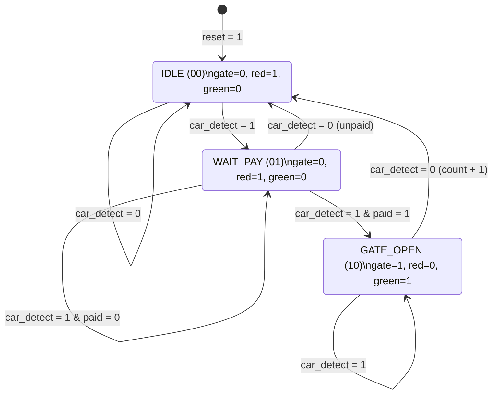

# Toll Booth Controller in Verilog (Moore FSM)

A digital Toll Booth Controller designed in Verilog HDL and simulated in ModelSim. The system uses a 3-state **Moore Finite State Machine (FSM)** to manage vehicle detection, toll payment verification, gate control, LED signaling, and paid vehicle counting.

---

## Features

- **3-State Moore FSM:** `IDLE`, `WAIT_PAY`, and `GATE_OPEN` for glitch-free, stable outputs.
- **Automated Gate & Signals:** Opens the gate and turns on the green LED only after payment is confirmed; keeps the red LED on otherwise.
- **Unpaid Exit Handling:** If a vehicle leaves before paying, the system resets to `IDLE` without incrementing the counter.
- **8-Bit Vehicle Counter:** Counts up to 255 paid vehicles that successfully pass through the gate.
- **Asynchronous Reset:** Instantly resets the FSM to `IDLE` and clears the car count without waiting for a clock edge.

---

## Repository Structure

```text
toll-booth-controller-verilog/
├── images/
│   ├── waveform.png    # ModelSim simulation waveform
│   └── transcript.png  # ModelSim transcript output log
├── toll_booth.v        # Main Verilog design module (synthesizable)
├── toll_booth_tb.v     # Testbench with 3 test scenarios
├── run.do              # One-command ModelSim simulation script
├── .gitignore          # Ignores temporary ModelSim files
└── README.md           # Project documentation
```

---

## Inputs and Outputs

| Signal | Direction | Width | Description |
| :--- | :---: | :---: | :--- |
| `clk` | Input | 1-bit | System clock (rising-edge triggered) |
| `reset` | Input | 1-bit | Asynchronous active-high reset (`1` = reset state & count) |
| `car_detect` | Input | 1-bit | Sensor input (`1` = car present at gate) |
| `paid` | Input | 1-bit | Payment signal (`1` = toll paid) |
| `gate_open` | Output | 1-bit | Gate actuator (`1` = open, `0` = closed) |
| `red_led` | Output | 1-bit | Stop indicator (`1` = ON) |
| `green_led` | Output | 1-bit | Go indicator (`1` = ON) |
| `car_count` | Output | 8-bit | Total count of cars that paid and passed |

---

## How It Works

### State Diagram



### State Transitions

| Current State | Condition | Next State | Action |
| :--- | :--- | :--- | :--- |
| **IDLE** (`2'b00`) | `car_detect == 0` | `IDLE` | Wait for vehicle |
| **IDLE** (`2'b00`) | `car_detect == 1` | `WAIT_PAY` | Car detected, wait for payment |
| **WAIT_PAY** (`2'b01`) | `car_detect == 0` | `IDLE` | Car left without paying (not counted) |
| **WAIT_PAY** (`2'b01`) | `car_detect == 1 && paid == 0` | `WAIT_PAY` | Keep waiting for payment |
| **WAIT_PAY** (`2'b01`) | `car_detect == 1 && paid == 1` | `GATE_OPEN` | Payment received, open gate |
| **GATE_OPEN** (`2'b10`) | `car_detect == 1` | `GATE_OPEN` | Keep gate open while car passes |
| **GATE_OPEN** (`2'b10`) | `car_detect == 0` | `IDLE` | Car passed, close gate, `car_count + 1` |

### Outputs per State (Moore Model)

| State | `gate_open` | `red_led` | `green_led` |
| :--- | :---: | :---: | :---: |
| `IDLE` | `0` | `1` | `0` |
| `WAIT_PAY` | `0` | `1` | `0` |
| `GATE_OPEN` | `1` | `0` | `1` |

---

## How to Run in ModelSim

### Option 1: Using `run.do` (Fastest)
1. Clone or download this repository into a folder.
2. Open **ModelSim** and change directory to your project folder (`File → Change Directory`).
3. Run this single command in the **Transcript** window:

```tcl
do run.do
```

### Option 2: Manual Transcript Commands
In the ModelSim **Transcript** window, type:

```tcl
vlog toll_booth.v toll_booth_tb.v
vsim work.toll_booth_tb
add wave -r /*
run -all
```
Then click **View → Zoom → Zoom Full** to see the complete waveform.

### Option 3: Using the ModelSim GUI
1. Open ModelSim and go to **File → New → Project**.
2. Name the project and select the folder containing `toll_booth.v` and `toll_booth_tb.v`.
3. Click **Add Existing File** and add both `.v` files.
4. Click **Compile → Compile All** (ensure both files show a green tick).
5. Go to **Simulate → Start Simulation**, expand `work`, select `toll_booth_tb`, and click **OK**.
6. In the Transcript window, type `add wave -r /*` followed by `run -all`.

---

## Testbench Scenarios & Expected Results

The testbench (`toll_booth_tb.v`) uses a `10 ns` clock period (`#5` half-period) and verifies three scenarios:
1. **Test 1 (Paid):** Car arrives → pays → gate opens → car passes → `car_count` becomes `1`.
2. **Test 2 (Unpaid):** Car arrives → leaves without paying → returns to `IDLE` → `car_count` stays `1`.
3. **Test 3 (Paid):** Another car arrives → pays → passes → `car_count` becomes `2`.

### Verification Checklist
- `car_count` ends at **`2`**.
- `gate_open` and `green_led` go high (`1`) **only** when `state` is `GATE_OPEN` (`2'b10`).
- `red_led` is high (`1`) in both `IDLE` and `WAIT_PAY`.

### Simulation Output

#### Waveform


#### Transcript Log


---

## Limitations & Future Improvements

- **Counter Overflow:** The 8-bit `car_count` wraps around from `255` back to `0`.
- **Single Lane:** Currently supports one toll lane at a time.
- **Future Scope:** Multi-lane support, vehicle-type fee calculation, payment timeout timer, and 7-segment display output.
