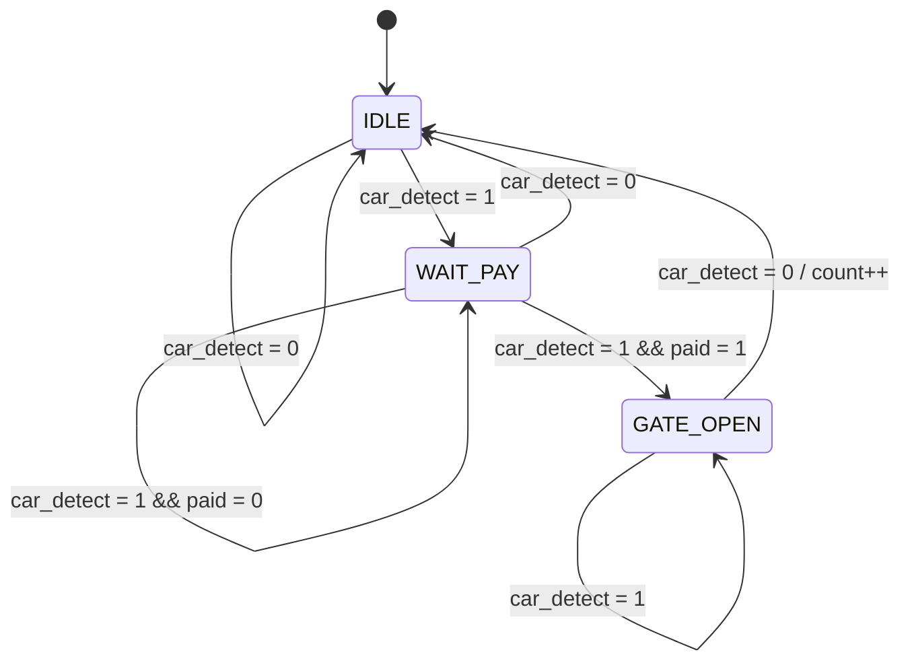

# Toll Booth Controller

<p align="center">
  <a href="https://www.intel.com/content/www/us/en/software/programmable/quartus-prime/download.html"></a>
  <a href="https://www.intel.com/content/www/us/en/products/details/fpga/development-tools/quartus-prime.html"></a>
  <a href="https://github.com/ShivamGawade-XS/Toll-Booth-Controller/blob/main/LICENSE"></a>
</p>

A Verilog HDL toll booth controller implemented with a 3-state **Moore finite state machine (FSM)**. It detects a vehicle, waits for payment, opens the gate, and increments an 8-bit vehicle counter only after a paid vehicle completes passage.

---

## Table of Contents

- [Features](#features)
- [How It Works](#how-it-works)
- [FSM States](#fsm-states)
- [State Diagram](#state-diagram)
- [Inputs and Outputs](#inputs-and-outputs)
- [Project Structure](#project-structure)
- [Run the Simulation](#run-the-simulation)
- [Simulation Results](#simulation-results)
- [Test Coverage](#test-coverage)
- [Limitations and Future Improvements](#limitations-and-future-improvements)

---

## Features

- 3-state Moore FSM: `IDLE`, `WAIT_PAY`, and `GATE_OPEN`
- Payment-controlled gate operation
- Unpaid vehicle handling without counting
- 8-bit counter for passed paid vehicles
- Asynchronous active-high reset
- ModelSim-compatible Verilog-2001 design and testbench
- Automated assertions for reset, payment, LEDs, and vehicle count

---

## How It Works

1. The controller remains in `IDLE` while no vehicle is detected.
2. When `car_detect` becomes `1`, it enters `WAIT_PAY` and keeps the gate closed.
3. If the vehicle leaves before payment, the FSM returns to `IDLE` and the count does not increase.
4. When `paid` becomes `1`, the FSM enters `GATE_OPEN` and activates the gate and green LED.
5. When the vehicle leaves while in `GATE_OPEN`, the gate closes and `car_count` increments once.

---

## FSM States

| State | Encoding | Gate | Red LED | Green LED | Description |
| :--- | :---: | :---: | :---: | :---: | :--- |
| `IDLE` | `2'b00` | 0 | 1 | 0 | Waiting for a vehicle |
| `WAIT_PAY` | `2'b01` | 0 | 1 | 0 | Vehicle detected; payment pending |
| `GATE_OPEN` | `2'b10` | 1 | 0 | 1 | Payment confirmed; vehicle passing |

### State Transitions

| Current State | Condition | Next State | Action |
| :--- | :--- | :--- | :--- |
| `IDLE` | `car_detect == 0` | `IDLE` | Continue waiting |
| `IDLE` | `car_detect == 1` | `WAIT_PAY` | Wait for payment |
| `WAIT_PAY` | `car_detect == 1 && paid == 0` | `WAIT_PAY` | Keep gate closed |
| `WAIT_PAY` | `car_detect == 0` | `IDLE` | Unpaid vehicle leaves; no count |
| `WAIT_PAY` | `car_detect == 1 && paid == 1` | `GATE_OPEN` | Open gate |
| `GATE_OPEN` | `car_detect == 1` | `GATE_OPEN` | Keep gate open |
| `GATE_OPEN` | `car_detect == 0` | `IDLE` | Close gate and increment count |

---

## State Diagram



---

## Inputs and Outputs

| Signal | Direction | Width | Description |
| :--- | :---: | :---: | :--- |
| `clk` | Input | 1 bit | Rising-edge system clock |
| `reset` | Input | 1 bit | Asynchronous active-high reset |
| `car_detect` | Input | 1 bit | `1` while a vehicle is at the gate |
| `paid` | Input | 1 bit | `1` when payment is confirmed |
| `gate_open` | Output | 1 bit | `1` when the gate is open |
| `red_led` | Output | 1 bit | Stop indicator |
| `green_led` | Output | 1 bit | Go indicator |
| `car_count` | Output | 8 bits | Number of paid vehicles that passed |

> The 8-bit counter wraps from `255` back to `0` when it overflows.

---

## Project Structure

```text
Toll-Booth-Controller/
├── images/
│   ├── transcript.png
│   └── waveform.png
├── .gitignore
├── README.md
├── run.do
├── toll_booth.v
└── toll_booth_tb.v
```

| File | Purpose |
| :--- | :--- |
| `toll_booth.v` | FSM, output logic, and vehicle counter |
| `toll_booth_tb.v` | Clock, reset, stimulus, and automated checks |
| `run.do` | ModelSim build and simulation script |
| `images/transcript.png` | Transcript result screenshot |
| `images/waveform.png` | ModelSim waveform screenshot |

---

## Run the Simulation

### Requirements

- Windows
- ModelSim SE Plus 5.7g or a compatible Verilog simulator

### Automated Run

Open ModelSim, change to the project directory, and enter:

```tcl
cd C:/path/to/Toll-Booth-Controller
do run.do
```

The script creates a `work` library if needed, compiles both Verilog files, launches the testbench, adds all signals to the Wave window, and runs until `$finish`.

### Manual Run

```tcl
vlib work
vlog -work work toll_booth.v
vlog -work work toll_booth_tb.v
vsim work.toll_booth_tb
add wave -r sim:/toll_booth_tb/*
run -all
```

Use **Zoom Full** from the Wave window toolbar or menu to fit the complete waveform.

### Expected Transcript

```text
ASYNCHRONOUS RESET CHECK PASSED
TEST 1 PASSED
TEST 2 PASSED
TEST 3 PASSED
ALL TESTS PASSED: car_count=2, gate_open=0, red_led=1, green_led=0
```

---

## Simulation Results

### ModelSim Transcript

<p align="center">
  
</p>

The transcript confirms that asynchronous reset, all three test scenarios, and the final state of the controller pass successfully.

### Simulation Waveform

<p align="center">
  
</p>

The waveform demonstrates the reset pulse, unpaid-vehicle departure, paid gate operation, and counter increments from `0` to `2`.

---

## Test Coverage

| Scenario | Expected Result |
| :--- | :--- |
| Asynchronous reset | Count = `0`; state = `IDLE`; red LED = `1` |
| First paid vehicle | Gate opens once payment is asserted; count becomes `1` after departure |
| Unpaid vehicle | Gate remains closed; count remains `1` |
| Second paid vehicle | Gate opens and count becomes `2` after departure |
| Final state | Gate = `0`; red LED = `1`; green LED = `0`; count = `2` |

---

## Limitations and Future Improvements

### Current Limitations

- Supports one vehicle and one toll lane at a time
- No vehicle-type or fee calculation
- No payment timeout
- Counter wraps after `255`
- No 7-segment or external display output

### Possible Improvements

- Multi-lane toll booth support
- Vehicle classification and dynamic pricing
- Payment timeout and cancellation logic
- 7-segment vehicle counter display
- FPGA board integration
- Coverage-driven verification

---

## License

This project is available under the [MIT License](LICENSE).

## Author

[Shivam Gawade](https://github.com/ShivamGawade-XS)
