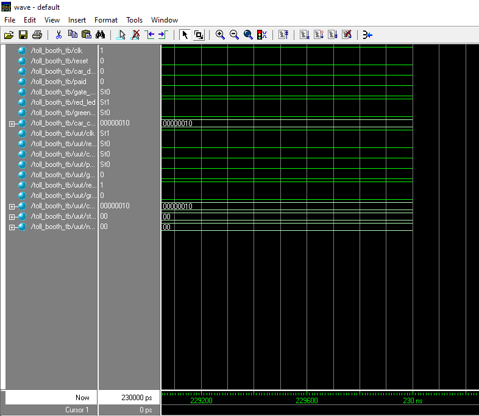
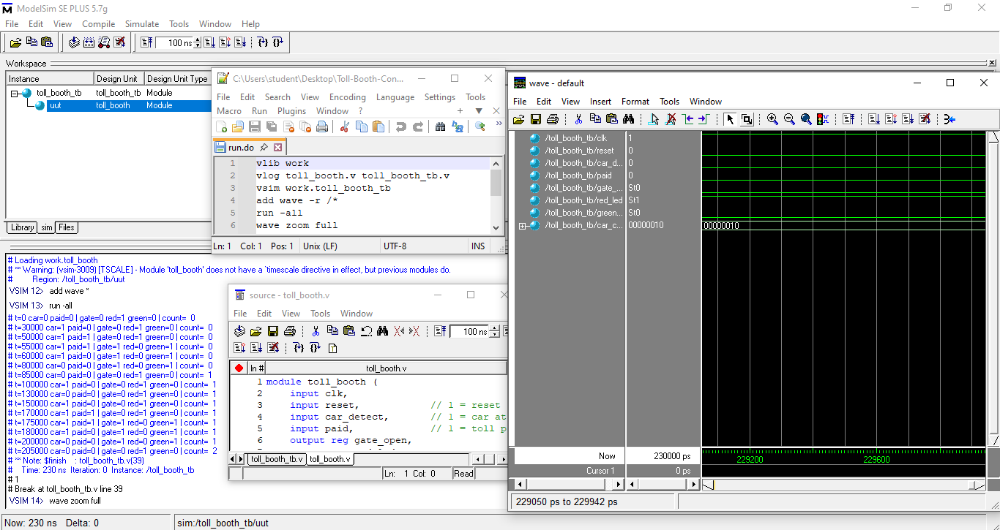

# Toll Booth Controller in Verilog (Moore FSM)

A digital Toll Booth Controller designed in Verilog HDL and simulated in ModelSim. The system uses a 3-state **Moore Finite State Machine (FSM)** to manage vehicle detection, toll payment verification, gate control, LED signaling, and paid vehicle counting.

---

## Features

- **3-State Moore FSM:** `IDLE`, `WAIT_PAY`, and `GATE_OPEN` for glitch-free, stable outputs.
- **Automated Gate & Signals:** Opens the gate and turns on the green LED only after payment is confirmed; keeps the red LED on otherwise.
- **Unpaid Exit Handling:** If a vehicle leaves before paying, the system resets to `IDLE` without incrementing the counter.
- **8-Bit Vehicle Counter:** Counts up to 255 paid vehicles that successfully pass through the gate.
- **Asynchronous Reset:** Instantly resets the FSM to `IDLE` and clears the car count without waiting for a clock edge.

---

## Repository Structure

```text
toll-booth-controller-verilog/
├── toll_booth.v        # Main Verilog design module (synthesizable)
├── toll_booth_tb.v     # Testbench with 3 test scenarios
├── images/             # (Optional) Add your waveform & transcript screenshots here
└── README.md           # Project documentation


### Simulation Output

#### Waveform


#### Transcript Log

